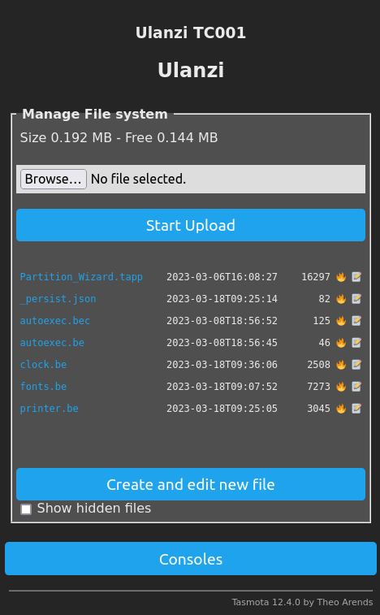

# 🕰️ Ulanzi TC001 Pixel Clock (Tasmota)

A collection of Berry scripts to transform your Ulanzi TC001 into a feature-rich pixel clock running on Tasmota firmware.

## ✨ Features

- **Multi-Face Display**: Switch between different information screens.
- **Dynamic Weather**: Real-time temperature and weather updates via Open-Meteo API.
- **Environmental Sensors**: Display Humidity, Temperature, Dew Point, and Illuminance.
- **Smart Brightness**: Automatic brightness adjustment based on ambient light.
- **System Status**: Monitor Battery level, IP address, MAC address, and RSSI.
- **Custom Colors**: Cycle through different colors for the display.
- **Customizable**: Easy to add new clock faces by extending \`BaseClockFace\`.

## 🚀 Installation

### ⚠️ Warning
Flashing custom firmware can brick your device and void your warranty. Proceed with caution.

### Step 1: Flash Tasmota
1. Download the Tasmota firmware from the [official website](http://ota.tasmota.com/tasmota32/release/).
2. Follow the [Tasmota Ulanzi TC001 installation guide](https://templates.blakadder.com/ulanzi_TC001.html).
3. **Essential Console Commands**:
   - \`Pixels 256\` - Enable 256-pixel display mode.
   - \`SetOption73 1\` - Decouple buttons from controlling power outputs.
   - \`Timezone +2:00\` - Set your local timezone (adjust \`+2:00\` as needed).

### Step 2: Install Berry Scripts
The clock functionality is powered by Berry scripts. You need to upload them to the device's file system.

1. Open the Tasmota web interface.
2. Navigate to **Consoles** $\rightarrow$ **Manage File System**.
3. Create the following files and paste the contents from this repository:
   - \`fonts.be\` - Custom font definitions.
   - \`autoexec.be\` - The main entry point for the clock.
   - \`ClockfaceManager.be\`, \`MatrixController.be\`, \`BaseClockFace.be\`, etc. (all \`.be\` files in the root).
4. Restart the device.

## 🎮 Usage & Controls

Use the buttons on the device to navigate the interface:

| Button | Action | Details |
| :--- | :--- | :--- |
| **Left** | ⬅️ Previous Face | Cycle through: Time $\rightarrow$ Date $\rightarrow$ Weather $\rightarrow$ Sensors $\rightarrow$ Network |
| **Right** | ➡️ Next Face | Cycle through: Time $\rightarrow$ Date $\rightarrow$ Weather $\rightarrow$ Sensors $\rightarrow$ Network |
| **Middle** | ⚙️ Mode/Color | Changes the mode of the current face or cycles colors |

### Face Modes
- **Date**: \`DAY.MONTH\` $\rightarrow$ \`YEAR\`
- **Sensors**: \`Illuminance\` $\rightarrow$ \`Humidity\` $\rightarrow$ \`Temperature\` $\rightarrow$ \`DewPoint\` $\rightarrow$ \`Battery\`
- **Network**: \`RSSI\` $\rightarrow$ \`IP\` $\rightarrow$ \`MAC\`

## 🛠️ Configuration

### Weather Location
By default, the clock uses coordinates for Switzerland. To change your location:
1. Open the Tasmota Console.
2. Enter the following commands (replacing the values with your coordinates):
   \`\`\`bash
   persist.latitude = 'your_lat'
   persist.longitude = 'your_lon'
   persist.save()
   \`\`\`

## 📁 Project Structure

- \`autoexec.be\`: Initialization script.
- \`ClockfaceManager.be\`: Coordinates face switching and input handling.
- \`MatrixController.be\`: Low-level LED matrix driver.
- \`BaseClockFace.be\`: Abstract class for all display faces.
- \`Weather.be\`: Handles API requests to Open-Meteo.
- \`fonts.be\`: Font bitmaps and color palettes.

## 🙏 Acknowledgments

- Huge thanks to [Hypfer/ulanzi-tc001-tasmota](https://github.com/Hypfer/ulanzi-tc001-tasmota) for the original software design and for solving complex hardware issues.

## 🔗 Useful Links

- [PixelIt Ulanzi](https://github.com/aptonline/PixelIt_Ulanzi)
- [ESPHome Pixel Clock](https://blakadder.com/esphome-pixel-clock/)
- [Open-Meteo API Documentation](https://open-meteo.com/en/docs)

---
*Happy hacking!*
